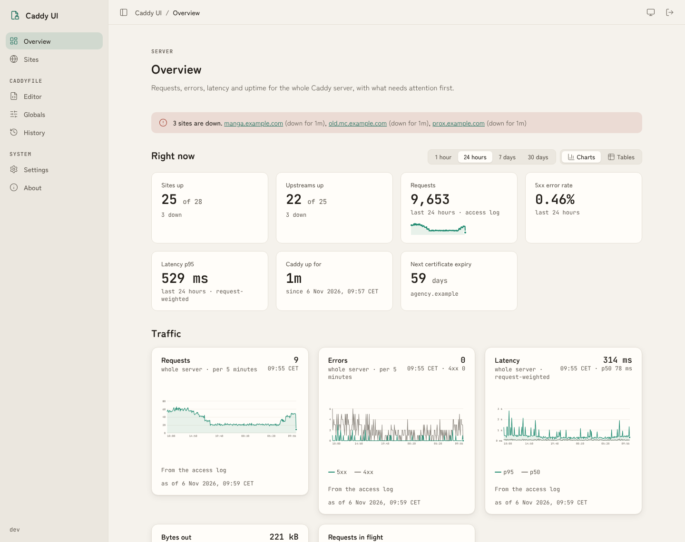
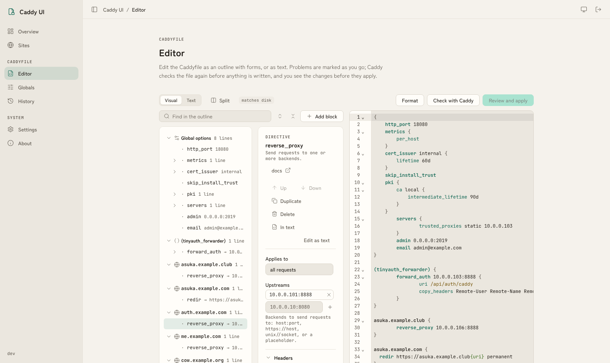
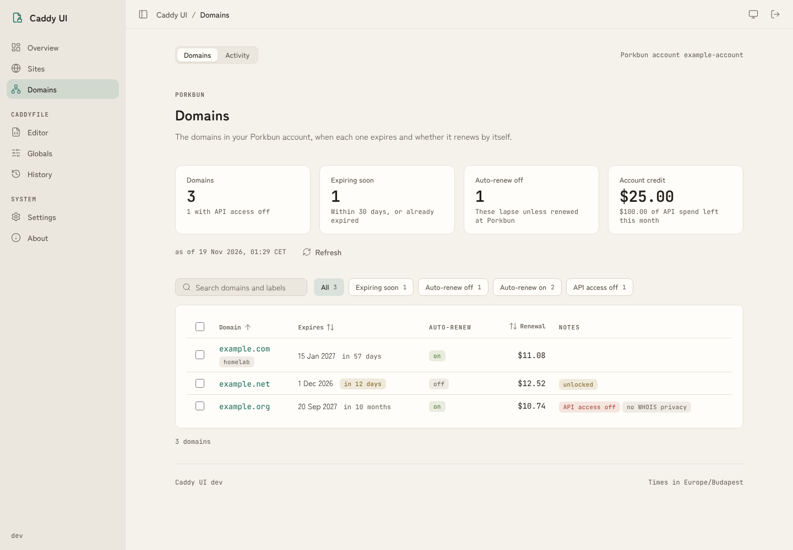
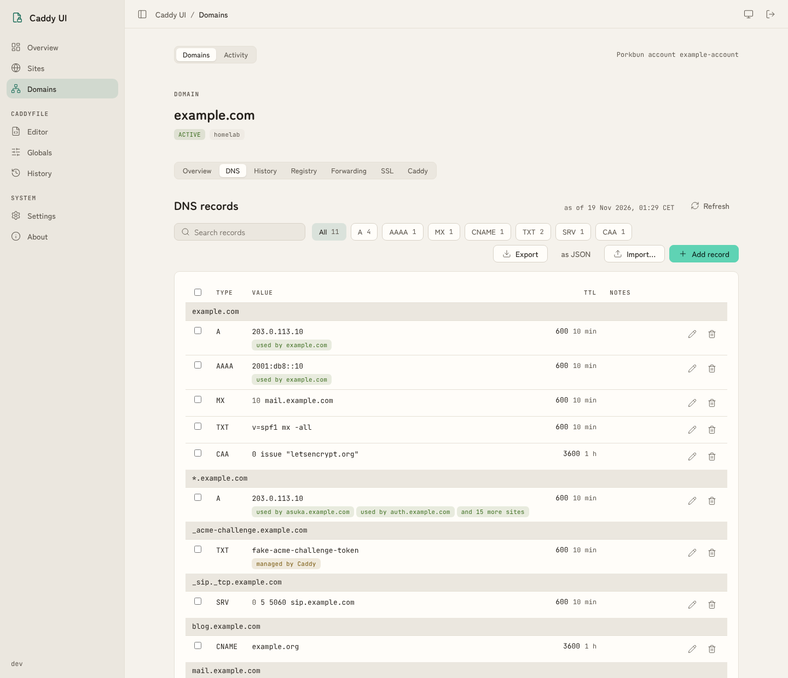
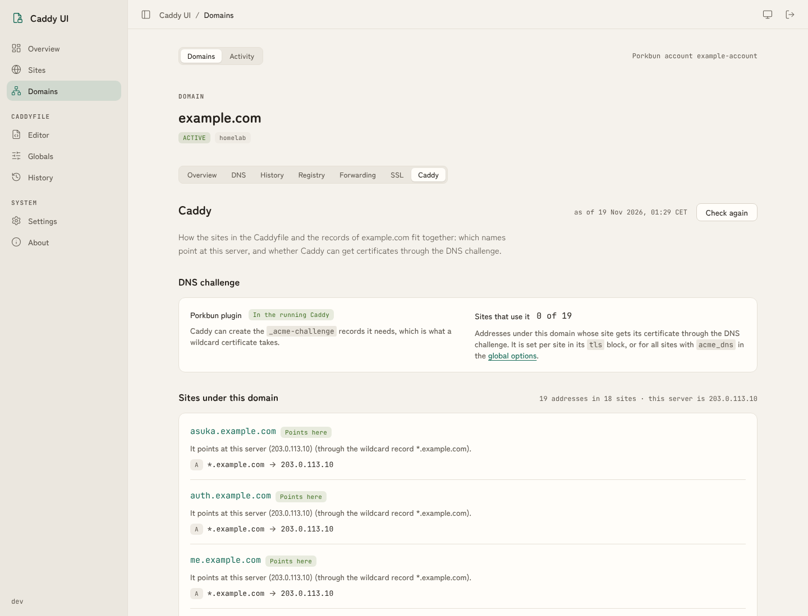

# Caddy UI

A self-hosted web UI for [Caddy](https://caddyserver.com). Edit your Caddyfile visually or
as syntax-highlighted text, see which sites and upstreams are up and for how long, and get
stats and charts for the whole server and for each site. It is one container that talks to
Caddy's admin API.

It replaces `zackwag/caddy-ui-frontend` and `zackwag/caddy-ui-backend` with a single
`caddy-ui` service.

## Features

- **Visual editor**: a tree outline and an inspector. Every standard directive and matcher
  has its own form, with a generic form for plugin directives and a raw fallback. Comments
  survive. Switch between Visual, Text and Split at any time. See
  [docs/editor.md](docs/editor.md).
- **Text editor**: CodeMirror with Caddyfile highlighting, lint from a real parser and from
  Caddy's `/adapt`, autocomplete and hover docs from a schema generated from the Caddy docs.
- **Safe apply**: a diff first, then validation, a backup revision, and a reload through the
  admin API. One click restores any earlier revision. Edits made outside the UI are detected.
- **Sites**: status per site and per upstream, "up for" times, certificate expiry. Add (from
  recipes), duplicate, disable, delete and reorder sites.
- **Stats**: charts for the server and each site, from Caddy's metrics, its JSON access log,
  certificate files and the UI's own probes. Each chart has a table view and names its
  source. See [docs/stats.md](docs/stats.md).
- **Discord notifications**: a message when a site goes down or comes back, a certificate nears
  its end, the Caddyfile changes outside the UI, or an update is applied. Each message is an
  editable Components v2 template with a live preview. See
  [docs/notifications.md](docs/notifications.md).
- **Updater**: an optional sidecar that redeploys the UI when a new image is published.
- **Porkbun domains (optional):** manage DNS records, restore points, nameservers, DNSSEC,
  forwarding and the SSL bundle for your Porkbun domains, with review-before-apply on every
  change. See [docs/porkbun.md](docs/porkbun.md).
- Built on the Fishnet design system, with a teal-green accent.

## Screenshots

The screenshots follow your GitHub theme (light or dark). They show the anonymised sample Caddyfile with
made-up traffic; see [docs/testing.md](docs/testing.md#screenshots) for how they are taken.

**Overview**: what needs attention first, then requests, errors and latency for the whole server.

<picture>
  <source media="(prefers-color-scheme: dark)" srcset="docs/screenshots/overview-dark.png">
  
</picture>

**Sites**: every site block with its status, how long it has been up, upstreams, 24 hour uptime and certificate.

<picture>
  <source media="(prefers-color-scheme: dark)" srcset="docs/screenshots/sites-dark.png">
  
</picture>

**A site**: uptime, traffic and each upstream for one site block.

<picture>
  <source media="(prefers-color-scheme: dark)" srcset="docs/screenshots/site-dark.png">
  
</picture>

**Visual editor**: the Caddyfile as an outline, with a form for the selected directive.

<picture>
  <source media="(prefers-color-scheme: dark)" srcset="docs/screenshots/editor-visual-dark.png">
  
</picture>

**Split view**: outline, form and text side by side; an edit in one shows up in the others.

<picture>
  <source media="(prefers-color-scheme: dark)" srcset="docs/screenshots/editor-split-dark.png">
  
</picture>

**Text editor**: CodeMirror with Caddyfile highlighting, lint and hover docs.

<picture>
  <source media="(prefers-color-scheme: dark)" srcset="docs/screenshots/editor-text-dark.png">
  
</picture>

**Domains**: the domains in a Porkbun account, with expiry, auto-renew and renewal price (optional; see
[docs/porkbun.md](docs/porkbun.md)).

<picture>
  <source media="(prefers-color-scheme: dark)" srcset="docs/screenshots/domains-dark.png">
  
</picture>

**DNS records**: a domain's records grouped by name, marked where a site in the Caddyfile uses them or Caddy
manages them; changes collect in a tray and are reviewed before they are sent.

<picture>
  <source media="(prefers-color-scheme: dark)" srcset="docs/screenshots/domain-dns-dark.png">
  
</picture>

**Caddy and DNS**: whether Caddy has the Porkbun plugin, and whether every site under the domain points at
this server.

<picture>
  <source media="(prefers-color-scheme: dark)" srcset="docs/screenshots/domain-caddy-dark.png">
  
</picture>

## Quick start

1. Make sure Caddy's global options include `admin 0.0.0.0:2019` and that Caddy and the UI
   share a Docker network. Do not publish the admin port.
2. Add the `caddy-ui` service from [`deploy/compose.example.yml`](deploy/compose.example.yml)
   to your compose file. It needs `CADDY_UI_PASSWORD` and `CADDY_UI_SESSION_SECRET`:

   ```yaml
   caddy-ui:
     image: ghcr.io/kex1016/caddy-ui:latest
     restart: unless-stopped
     ports: ['9876:3001']
     environment:
       CADDY_ADMIN_URL: http://caddy:2019
       CADDY_UI_USER: admin
       CADDY_UI_PASSWORD: change-me
       CADDY_UI_SESSION_SECRET: a-long-random-string
       TZ: Europe/Budapest
     volumes:
       - ./Caddyfile:/etc/caddy/Caddyfile
       - ./data:/data:ro
       - ./logs:/var/log/caddy:ro
       - ./caddy-ui:/etc/caddy-ui
     networks: [caddy-ui]
   ```

3. `docker compose up -d caddy-ui`, then open `http://<host>:9876`.

Details, including optional metrics and access logging, are in
[docs/install.md](docs/install.md). Coming from the zackwag images? See
[docs/migration-from-caddy-ui.md](docs/migration-from-caddy-ui.md).

## Configuration

Configuration comes from environment variables, for example `CADDY_UI_PORT`, `CADDY_ADMIN_URL`
and `CADDYFILE_PATH`. The complete table is in [docs/configuration.md](docs/configuration.md).

The **Settings** page changes twelve of them while the UI runs, without a restart: the probe and
metrics intervals, how many days of probe results to keep, the probe timeout, when a certificate
counts as close to expiry, how many Caddyfile revisions and backups to keep, the time zone, the
public address, the Porkbun read-only switch and cache lifetime, and how often the updater checks
for a new version. A value saved there wins over the environment until you press "Use the
environment's value". The page also shows every other variable with its value (secrets only as set
or unset), checks the mounted paths, tests the admin API and the Porkbun keys, shows how large the
database is per table, and lists who changed what. **Check everything** runs every health check at
once; per-site probe options skip a site, probe another path or count a status as up; two Caddy
helpers turn on per-host metrics and the JSON access log as a reviewed Caddyfile change; the storage
tools prune, compact and download a backup; and the Updates section shows the updater's last check
and newest version, with a "Check now" button. See
[docs/configuration.md](docs/configuration.md#the-settings-page).

Settings is also where Discord notifications are set up: paste a channel's webhook URL (it is
never shown again), pick the events, and edit each message with a live preview and **Send test**.
See [docs/notifications.md](docs/notifications.md).

## Development

Needs Node 22 and pnpm 10 (`corepack enable`).

```sh
pnpm install
pnpm dev          # http://localhost:5173
pnpm check        # lint, typecheck, unit tests
pnpm build        # production build of apps/ui
docker build -t caddy-ui .
```

The repo is a pnpm workspace: `apps/ui` is the SvelteKit app (UI and API), `packages/*` hold
the Caddyfile parser and the directive schema. See [docs/architecture.md](docs/architecture.md).

## Documentation

| Guide | What it covers |
| --- | --- |
| [docs/install.md](docs/install.md) | Install, prerequisites, first run, updating |
| [docs/configuration.md](docs/configuration.md) | Every environment variable, auth modes, volumes |
| [docs/architecture.md](docs/architecture.md) | How the pieces fit; for contributors |
| [docs/editor.md](docs/editor.md) | The visual and text editors |
| [docs/porkbun.md](docs/porkbun.md) | Managing Porkbun domains and the Caddy DNS plugin: keys, sandbox, safety rules, errors |
| [docs/stats.md](docs/stats.md) | Where each number comes from and what to enable |
| [docs/notifications.md](docs/notifications.md) | Discord notifications: setup, events, editing messages, delivery |
| [docs/migration-from-caddy-ui.md](docs/migration-from-caddy-ui.md) | Swapping the zackwag images for this one |
| [docs/faq.md](docs/faq.md) | Common questions and fixes |
| [docs/caddy-coverage.md](docs/caddy-coverage.md) | Every directive and matcher the editor supports |
| [docs/testing.md](docs/testing.md) | How it is tested: e2e, accessibility, performance budget, Caddy versions |

Project process documents: [PLAN.md](PLAN.md), [AUTOPILOT.md](AUTOPILOT.md),
[DECISIONS.md](DECISIONS.md), [TODO-USER.md](TODO-USER.md).

## License

MIT. See [LICENSE](LICENSE).
